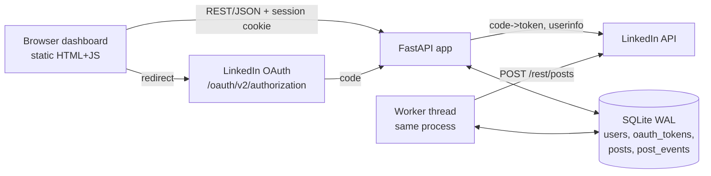

# 02 - Technical Specification

## 1. Architecture



One process. Worker thread started in FastAPI lifespan, stopped via `threading.Event` on shutdown.

## 2. OAuth 2.0 flow (authorization code)

Scopes: `openid profile email w_member_social`.

1. `GET /auth/login` -> generate `state` (secrets.token_urlsafe), store in session, 302 to
   `https://www.linkedin.com/oauth/v2/authorization?response_type=code&client_id=..&redirect_uri=..&state=..&scope=openid%20profile%20email%20w_member_social`
2. LinkedIn redirects to `GET /auth/callback?code=..&state=..`. Verify `state` equals session value (CSRF), else 400.
3. `POST https://www.linkedin.com/oauth/v2/accessToken` (form: `grant_type=authorization_code, code, redirect_uri, client_id, client_secret`) -> `access_token`, `expires_in` (~60 days), `scope`. Self-serve apps get no refresh token; if one is returned, store it encrypted too.
4. `GET https://api.linkedin.com/v2/userinfo` (Bearer) -> `sub`, `name`, `email`, `picture`.
5. Upsert `users` by `linkedin_sub`; upsert `oauth_tokens` with encrypted token; set session `user_id`; 302 to `/`.
6. Token expiry: `expires_at` stored. Dashboard shows days left. Expired/401 -> posts fail with clear message "reconnect LinkedIn"; user logs in again (new token replaces old), then can reschedule.

Redirect URI must match exactly what is registered in the LinkedIn app: `http://localhost:8000/auth/callback`.

## 3. Database schema (SQLite, `schema.sql`)

```sql
PRAGMA journal_mode = WAL;
PRAGMA foreign_keys = ON;

CREATE TABLE IF NOT EXISTS users (
  id           INTEGER PRIMARY KEY AUTOINCREMENT,
  linkedin_sub TEXT NOT NULL UNIQUE,          -- OpenID subject; author URN = urn:li:person:<sub>
  name         TEXT NOT NULL DEFAULT '',
  email        TEXT NOT NULL DEFAULT '',
  picture      TEXT NOT NULL DEFAULT '',
  created_at   TEXT NOT NULL                  -- UTC ISO-8601
);

CREATE TABLE IF NOT EXISTS oauth_tokens (
  user_id           INTEGER PRIMARY KEY REFERENCES users(id) ON DELETE CASCADE,
  access_token_enc  BLOB NOT NULL,            -- Fernet ciphertext, never plaintext
  refresh_token_enc BLOB,                     -- usually NULL for self-serve apps
  scope             TEXT NOT NULL DEFAULT '',
  expires_at        TEXT NOT NULL,            -- UTC
  updated_at        TEXT NOT NULL
);

CREATE TABLE IF NOT EXISTS posts (
  id               INTEGER PRIMARY KEY AUTOINCREMENT,
  user_id          INTEGER NOT NULL REFERENCES users(id) ON DELETE CASCADE,
  content          TEXT NOT NULL CHECK (length(content) BETWEEN 1 AND 3000),
  content_hash     TEXT NOT NULL,             -- sha256(normalized content)
  scheduled_at     TEXT NOT NULL,             -- UTC, user-chosen publish time
  status           TEXT NOT NULL DEFAULT 'scheduled'
                   CHECK (status IN ('scheduled','processing','published','failed')),
  attempts         INTEGER NOT NULL DEFAULT 0,
  max_attempts     INTEGER NOT NULL DEFAULT 5,
  next_attempt_at  TEXT NOT NULL,             -- starts = scheduled_at; pushed out on retry
  locked_at        TEXT,                      -- set when claimed (processing)
  linkedin_post_urn TEXT UNIQUE,              -- set the moment LinkedIn returns 201
  last_error       TEXT,
  published_at     TEXT,
  created_at       TEXT NOT NULL,
  updated_at       TEXT NOT NULL,
  UNIQUE (user_id, content_hash, scheduled_at) -- same post+time cannot be created twice
);
CREATE INDEX IF NOT EXISTS idx_posts_due ON posts(status, next_attempt_at);

CREATE TABLE IF NOT EXISTS post_events (      -- per-post audit trail shown in UI
  id       INTEGER PRIMARY KEY AUTOINCREMENT,
  post_id  INTEGER NOT NULL REFERENCES posts(id) ON DELETE CASCADE,
  at       TEXT NOT NULL,
  level    TEXT NOT NULL,                     -- info | warn | error
  event    TEXT NOT NULL,                     -- created, claimed, attempt, retry_scheduled, published, failed, reaped
  detail   TEXT NOT NULL DEFAULT ''           -- sanitized; NEVER tokens
);
CREATE INDEX IF NOT EXISTS idx_events_post ON post_events(post_id, id);
```

## 4. Post state machine

```
 scheduled --(worker claims: due & atomic UPDATE)--> processing
 processing --(201 + URN)------------------------> published      (terminal)
 processing --(temporary error, attempts<max)----> scheduled      (attempts+1, next_attempt_at = now+backoff)
 processing --(temporary error, attempts==max)---> failed         (terminal)
 processing --(permanent/auth error)--------------> failed         (terminal)
 processing --(stuck > 10 min, reaper)-----------> scheduled      (event 'reaped', counts as an attempt)
 scheduled  --(user cancels)----------------------> deleted row    (only while status='scheduled')
 failed     --(user "retry now")--------------------> scheduled    (manual, resets attempts) [MUST-lite, 5 lines]
```

Only the four required status values exist. "Waiting for retry" is `scheduled` with `attempts>0` and a future `next_attempt_at`; the UI shows "retry 2/5 at 14:32".

## 5. Worker algorithm

Loop every `WORKER_POLL_SECONDS` (default 5):

1. **Reap:** `UPDATE posts SET status='scheduled', locked_at=NULL WHERE status='processing' AND locked_at < now-10min AND linkedin_post_urn IS NULL` (+ event). A row that already has a URN is forced to `published` instead (never re-posted).
2. **Claim (atomic, single statement):**
   ```sql
   UPDATE posts SET status='processing', locked_at=:now, attempts=attempts+1, updated_at=:now
   WHERE id = (SELECT id FROM posts
               WHERE status='scheduled' AND next_attempt_at <= :now AND linkedin_post_urn IS NULL
               ORDER BY next_attempt_at LIMIT 1)
     AND status='scheduled'
   RETURNING *;
   ```
   0 rows = nothing to do (or another worker won). Exactly one claimer can ever flip a row.
3. **Publish:** load + decrypt token; if `expires_at` passed -> permanent fail "token expired, reconnect". Call `publisher.publish(token, author_urn, content)` with connect 10 s / read 30 s timeouts.
4. **Result handling** (commit in the same step that sets URN, so a crash can't lose the URN):
   - success: `status='published', linkedin_post_urn=:urn, published_at=:now`
   - classify error (section 6) -> retry or fail.
5. Never raise out of the loop; log and continue. Sleep `stop.wait(poll)`.

## 6. Error classification

| LinkedIn / network result | Class | Action |
|---|---|---|
| 201 Created | success | published |
| connect error, DNS failure | temporary, NOT sent | retry (safe) |
| 429 Too Many Requests | temporary | retry; delay = max(backoff, `Retry-After`) |
| 500, 502, 503, 504 | temporary | retry |
| read timeout / connection reset mid-response | temporary, AMBIGUOUS | retry (documented duplicate risk, see 8) |
| 400, 422 (bad payload, content rules) | permanent | failed, `last_error` = LinkedIn message |
| 401 (expired/revoked token) | auth | failed, "reconnect LinkedIn" |
| 403 (missing scope / not permitted) | permanent | failed |
| 422/409 duplicate content from LinkedIn | permanent | failed with "LinkedIn rejected as duplicate"; if message indicates already posted, mark failed not retry |

Backoff schedule (attempt n just failed): `base=30s * 5^(n-1)` capped -> 30s, 150s(~2.5m), 12.5m, ~1h, cap 2h; plus 0-20% jitter. Env: `RETRY_BASE_SECONDS`, `RETRY_MAX_SECONDS`, `MAX_ATTEMPTS`. (Exact numbers are config, schedule above is default.)

## 7. REST API (all `/api/*` require session; 401 otherwise)

| Method | Path | Body / notes |
|---|---|---|
| GET | `/auth/login` | redirects to LinkedIn |
| GET | `/auth/callback` | OAuth callback |
| POST | `/auth/logout` | clears session |
| GET | `/api/me` | `{name, email, picture, token_expires_at, token_days_left}` |
| POST | `/api/posts` | `{content, scheduled_at}` (ISO UTC). Validates: 1-3000 chars, `scheduled_at` >= now - 30 s (past allowed within grace => publish immediately), UNIQUE violation -> 409 "duplicate scheduled post" |
| GET | `/api/posts` | current user's posts, newest first, with status/attempts/next_attempt_at/last_error/urn |
| GET | `/api/posts/{id}/events` | audit trail |
| DELETE | `/api/posts/{id}` | only if `status='scheduled'` and `attempts=0` |
| POST | `/api/posts/{id}/retry` | only if `status='failed'`; resets to scheduled now |
| GET | `/healthz` | `{ok, worker_alive, due_count}` |

Ownership check on every `{id}` route (`user_id = session user`).

## 8. Duplicate-post protection (layers)

1. DB UNIQUE `(user_id, content_hash, scheduled_at)`: double-click / double-submit cannot create two rows.
2. Atomic claim: only one worker/thread can move `scheduled -> processing` for a row.
3. `linkedin_post_urn` stored in the same commit as `published`; claim query excludes rows with a URN; reaper never resets a row with a URN.
4. Status guard on retry: retry only from `failed` and only for rows with no URN.
5. Known residual risk: if LinkedIn creates the post but the response is lost (read timeout), a retry can duplicate. Mitigation options documented (verify via list-my-posts needs `r_member_social`, restricted). Honest note in README.

## 9. Security

- Tokens: Fernet key `TOKEN_ENCRYPTION_KEY` from `.env`; startup fails if missing/invalid. Plaintext token only in memory during a request/publish.
- `LINKEDIN_CLIENT_SECRET`, `SESSION_SECRET` only in `.env` (git-ignored); `.env.example` has placeholders.
- Session cookie: signed (itsdangerous), `HttpOnly`, `SameSite=Lax`, `https_only` toggle via `COOKIE_SECURE`.
- OAuth `state` checked (CSRF). Redirect URI fixed from config, not request input.
- Log scrubber: log filter redacts `Bearer ...`, `access_token`, `client_secret` patterns; `post_events.detail` built only from status code + LinkedIn error message.
- Input: content length validated server-side; rendered with `textContent` in UI (no XSS).

## 10. Logging

- `logging` root config: console + `RotatingFileHandler(logs/app.log, 1 MB x 3)`.
- Format: `ts level logger post_id=.. user_id=.. msg`.
- Logged events: login, token stored (no value), post created, claimed, attempt N, retry scheduled (delay), published (URN), failed (reason), reaped, worker started/stopped.

## 11. Config (`app/config.py`, from `.env`)

`APP_BASE_URL, HOST, PORT, LINKEDIN_CLIENT_ID, LINKEDIN_CLIENT_SECRET, LINKEDIN_REDIRECT_URI, LINKEDIN_SCOPES, LINKEDIN_API_VERSION, TOKEN_ENCRYPTION_KEY, SESSION_SECRET, COOKIE_SECURE, DB_PATH, PUBLISH_MODE (live|dry_run), FAULT_INJECT, WORKER_POLL_SECONDS, MAX_ATTEMPTS, RETRY_BASE_SECONDS, RETRY_MAX_SECONDS, LOG_LEVEL`. Full list with how-to in 04-dependencies.md.

## 12. Dashboard (static JS)

- Logged out: product name + "Sign in with LinkedIn" button.
- Logged in: header (avatar, name, token days left, logout) -> form (textarea with char counter /3000, datetime-local, Schedule button) -> table of posts (status badge colors, scheduled time local, attempts, next retry, error, link to LinkedIn post when published, expand row = event log, Cancel / Retry-now buttons).
- Auto-refresh every 5 s via `setInterval(fetch)`.
- Banner when `PUBLISH_MODE=dry_run` ("no real posts will be made").

## 13. Test plan (pytest, offline, fake publisher)

| Test | Proves |
|---|---|
| backoff schedule + jitter + Retry-After | increasing delays |
| two threads claim same row | exactly one wins |
| temp error x2 then success | retries, final `published`, one URN |
| permanent 400 | `failed` immediately, no retry |
| 401 | `failed` with reconnect message |
| restart with `processing` row, no URN | reaper -> `scheduled` |
| row with URN never reposted | duplicate guard |
| token round trip + DB scan | no plaintext token |

Manual acceptance: criteria 1-3 in `BRIEF.md`, run live once with a real LinkedIn account.
