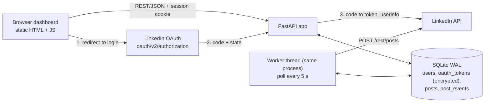
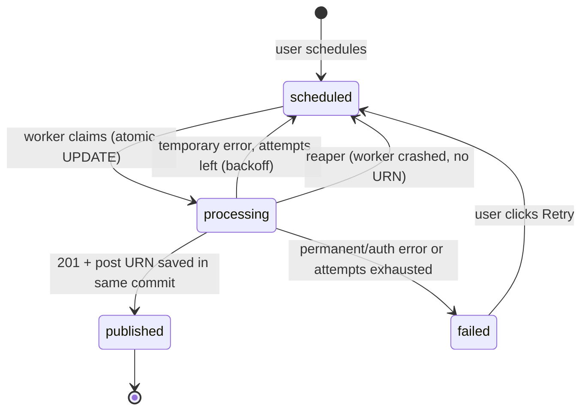

# Architecture

One Python process: FastAPI serves the REST API and the static JS dashboard, and starts a background worker thread. SQLite (WAL) is both the data store and the job queue.

## Post lifecycle

## Retry timeline (defaults)

Attempt 1 fails -> wait ~30 s, attempt 2 fails -> ~2.5 min, 3 -> ~12.5 min, 4 -> ~1 h (cap 2 h), each +0-20% jitter, `Retry-After` honoured. After 5 attempts the post is `failed`.

## Where each guarantee lives

| Guarantee | Mechanism | File |
|---|---|---|
| One worker wins a row | single `UPDATE ... RETURNING` guarded by `status='scheduled'` | `app/worker.py::claim_due` |
| Same post+time cannot be created twice | `UNIQUE(user_id, content_hash, scheduled_at)` -> HTTP 409 | `schema.sql`, `app/routes_posts.py` |
| Published post never re-posted | URN saved with `published`; claim query excludes rows with a URN; reaper skips them | `app/worker.py` |
| Tokens never in plaintext | Fernet, key in `.env` | `app/crypto.py` |
| Secrets never in logs | redacting log filter | `app/logs.py` |
